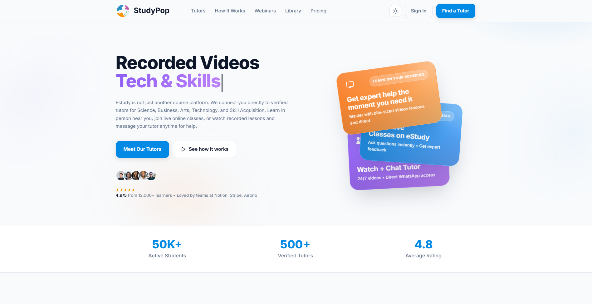

# PropertyPro Zambia

An interactive property and investment portfolio management dashboard prototype for PropertyPro Zambia. It brings day-to-day property operations and institutional investment oversight together in one browser-based application.

## Live demo

[Open the PropertyPro Zambia website](https://okeyodev.github.io/proto-company-dashboard-propertyPro-zambia/)

## Preview



## What you can explore

- **Portfolio overview:** Property and investment dashboards with portfolio metrics, charts, and cross-links.
- **Property management:** Property register, units, portfolio map, marketing and vacancies, tenant applications, tenants, and leases.
- **Finance and operations:** Billing and invoices, payments, arrears, service charges, maintenance, insurance, valuations, development projects, and property reports.
- **Investment management:** Investment assets, asset allocation, deal pipeline, appraisals, fixed income, listed and unlisted investments, collective investments, and cash management.
- **Investment oversight:** Risk, compliance, performance, and investment reports.
- **Enterprise workflows:** Approvals, conditions precedent, document register, audit trail, messages, notices, users and roles, and system settings.

### Connected property and investment records

Directly held property investments can be linked to their operational property records. Property income, operating costs, and valuations feed investment measures such as net operating income (NOI), yield, and portfolio performance. The prototype also includes reusable investment calculations such as NPV, IRR, DCF, TWRR, and allocation drift.

## Run locally

This is a static front-end project; there is no build step or package installation.

1. Clone the repository:

   ```bash
   git clone https://github.com/okeyodev/proto-company-dashboard-propertyPro-zambia.git
   cd proto-company-dashboard-propertyPro-zambia
   ```

2. Start a local web server from the project directory:

   ```bash
   python -m http.server 8000
   ```

3. Open [http://localhost:8000](http://localhost:8000) in your browser. The property dashboard is the home page; use the sidebar to explore the other modules.

You can also open `index.html` directly in a browser. Some export features load libraries from a CDN and therefore require an internet connection.

## Technology and data

- HTML, CSS, and vanilla JavaScript; no front-end framework or build system.
- Demo data is initialized in the browser and saved in `localStorage` under `propertypro_v3` (with migration support for `propertypro_v2`).
- Data is local to the browser and is not synchronized to a server. This prototype does not provide a production backend or authentication.

## Project structure

```text
index.html                  Property dashboard entry point
pages/                      Property, investment, and enterprise screens
css/                        Shared styles and page-specific stylesheets
js/common.js                Shared state, demo data, and common UI behavior
js/layout.js                Navigation, sidebar, top bar, and breadcrumbs
js/investment-calculations.js
                            Shared investment and property calculations
js/pages/                   Page-specific interactions
Screenshot.png              Dashboard preview image
```
